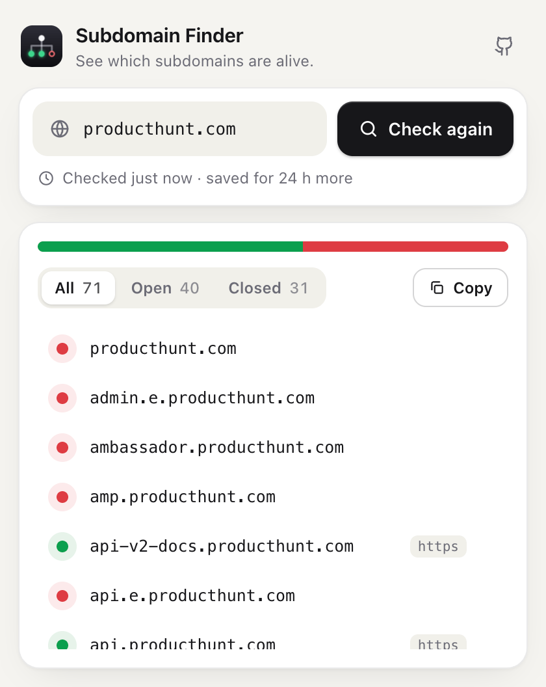

# Subdomain Finder

A lightweight browser extension that finds the subdomains of any domain and shows which ones are open, in one click.

Works in **Chrome, Edge, Opera and Firefox** (Manifest V3). Built with React and Vite.

<!-- Add a screenshot: save it as docs/screenshot.png and uncomment the line below.

-->

## Features

- Lists subdomains of the current site (or any domain you type) from public certificate transparency data.
- Sends a request to every subdomain and marks it open or closed with a colored dot.
- Filter by status (All / Open / Closed) and copy the visible list.
- Saves results for 24 hours per domain, so reopening the popup does not send anything again.
- Light and dark theme, follows your browser.
- No account, no tracking, no analytics, and no background process.

## Install

### From source

Requires [Node.js](https://nodejs.org) 18 or newer.

```bash
git clone https://github.com/sizucen/subdomain-finder.git
cd subdomain-finder
npm install
npm run build
```

This creates two builds:

- `dist/chromium` for Chrome, Edge, Opera and other Chromium browsers
- `dist/firefox` for Firefox

### Load it in your browser

| Browser | Steps |
| --- | --- |
| Chrome | Open `chrome://extensions`, turn on **Developer mode**, click **Load unpacked**, select `dist/chromium`. |
| Edge | Open `edge://extensions`, turn on **Developer mode**, click **Load unpacked**, select `dist/chromium`. |
| Opera | Open `opera://extensions`, turn on **Developer mode**, click **Load unpacked**, select `dist/chromium`. |
| Firefox | Open `about:debugging#/runtime/this-firefox`, click **Load Temporary Add-on**, select `dist/firefox/manifest.json`. |

Firefox removes temporary add-ons when it closes. For a permanent install, use a signed build from addons.mozilla.org.

## How to use

1. Open the extension on the site you want to check. Its domain is filled in for you, or type any domain.
2. Press **Check**. The extension fetches the subdomain list, then checks each one.
3. Use the tabs to filter by Open or Closed, and **Copy** to copy the list.
4. Reopen the popup any time within 24 hours to see the saved results. Press **Check again** to refresh them.

Dot colors: green is open, red is closed, amber is being checked, gray has not been checked yet.

## Data source

Subdomains come from [crt.name](https://crt.name), a search service for Certificate Transparency logs. These logs are public records of TLS certificates, and the hostnames in those certificates reveal many subdomains.

The extension calls one endpoint:

```
GET https://crt.name/v1/search?apex=example.com
```

The response is plain text with one hostname per line. Wildcard entries (`*.example.com`) and names outside the domain are ignored. This project is not affiliated with crt.name.

## How "open" is decided

Each subdomain gets a `GET /` request over HTTPS, then HTTP if HTTPS fails, with a 6 second timeout and up to 12 requests at a time.

- If a server answers, with any status code, the host is **Open**.
- If DNS, the connection or TLS fails, the host is **Closed**.

The requests use `no-cors` mode, so the extension never needs access to the sites it checks and cannot read their responses or status codes.

## Privacy and permissions

| Permission | Why it is needed |
| --- | --- |
| `activeTab` | Fills in the domain of the current tab when you open the popup. |
| `https://crt.name/*` | Fetches the subdomain list. |

Nothing is sent until you press **Check**. When you do, two things happen:

- The domain you checked is sent to crt.name.
- Your browser sends a request to each subdomain that was found.

Saved results stay in the extension's local storage on your device and are removed after 24 hours.

## Responsible use

Subdomain data comes from public records, and the checks are single, harmless `GET /` requests. Still, only scan domains you own or have permission to test.

## Limitations

- Only names that appeared in a public certificate are found. Subdomains with no certificate, or covered only by a wildcard certificate, will be missing.
- A host with an expired or invalid certificate and no working HTTP is reported as Closed.
- Open means the host answered. It does not mean the page works or is publicly accessible.
- The domain guessed from the current tab uses a small built-in list of second-level labels (`com.tr`, `co.uk`, ...). If it guesses wrong, edit the field.

## Development

```bash
npm install
npm run dev              # preview the popup UI in a normal tab (no extension APIs)
npm run build            # build for Chromium and Firefox
npm run build:chromium
npm run build:firefox
```

```
src/
  App.jsx          popup UI
  styles.css       styles and light/dark theme
  icons.jsx        inline SVG icons
  lib/
    crt.js         fetches and parses the crt.name list
    probe.js       open/closed check and request pool
    cache.js       24 hour result cache
    domain.js      domain parsing and apex guess
    browser.js     reads the active tab
manifest.config.js manifest for each browser
```

### Packaging

Zip the contents of the build folder (not the folder itself):

```bash
cd dist/chromium && zip -r ../subdomain-finder-chromium.zip . && cd ../..
cd dist/firefox  && zip -r ../subdomain-finder-firefox.zip . && cd ../..
```

Before publishing to a store, change the Firefox add-on id in `manifest.config.js`. Firefox's listing also asks you to declare data collection: the domain a user checks is sent to crt.name.

## Contributing

Issues and pull requests are welcome. Ideas: CSV export, adjustable concurrency, more languages, a text filter for the list.

## License

[MIT](LICENSE)
